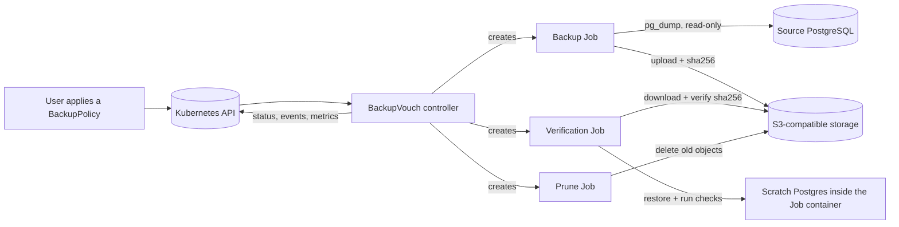
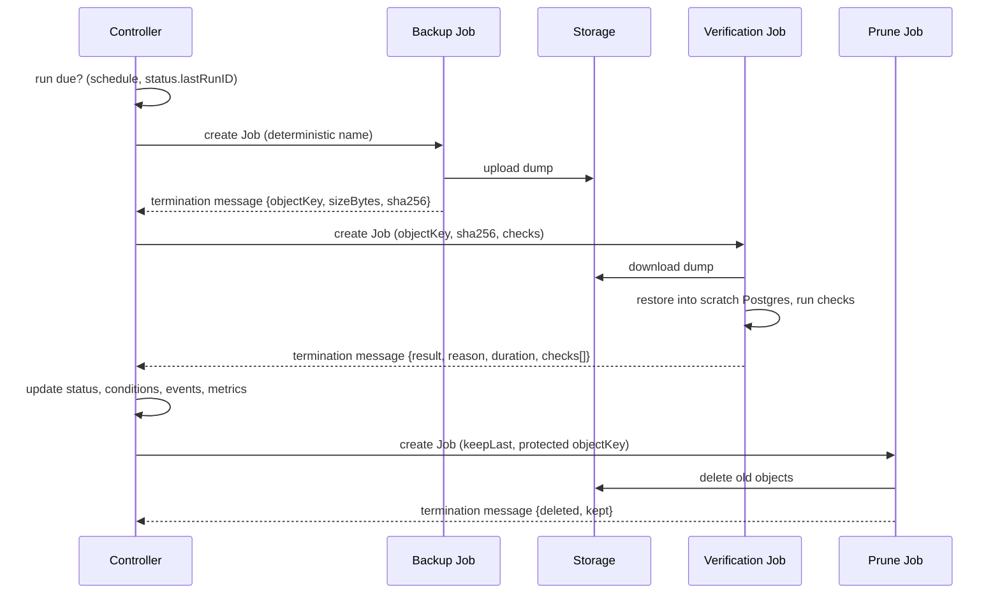
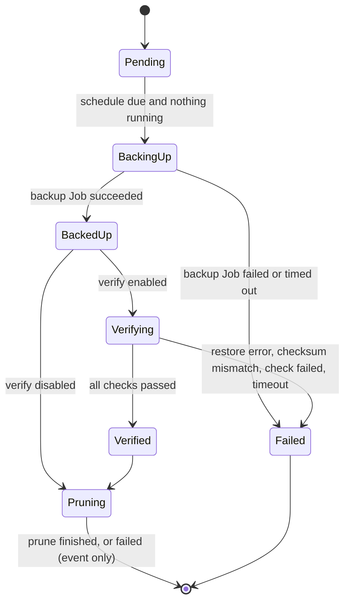

# ARCHITECTURE

## Components

- **Controller**: reconciles `BackupPolicy`. It decides when a run is due, creates Jobs, reads results, updates status, emits events and metrics. It never connects to the database or the storage itself, and never reads Secrets.
- **Runner image**: one image with three subcommands. `runner backup` dumps and uploads. `runner verify` downloads, restores, and checks. `runner prune` deletes old backup objects. It contains the Postgres client and server tools of one Postgres major version (see D15).
- **Jobs**: each run is up to three Kubernetes Jobs, owned by the BackupPolicy through owner references.
- **Scratch Postgres**: started with `initdb` and `pg_ctl` inside the verification Job's own container (non-root, fixed UID, data on an `emptyDir` with a size limit). No sidecar, no Service, nothing listening outside the container (the server listens on a Unix socket only).

## Labels and names

| Item | Value |
|---|---|
| Labels on Jobs and Pods | `backupvouch.dev/policy=<name>`, `backupvouch.dev/run-id=<runID>`, `backupvouch.dev/role=backup`, `verify` or `prune`, `app.kubernetes.io/managed-by=backupvouch` |
| Job names | `<policy>-backup-<runID>`, `<policy>-verify-<runID>`, `<policy>-prune-<runID>` |
| `runID` | the scheduled time as a Unix timestamp (10 digits); for a manual re-verification, the value of the annotation |
| Object key | `<storage.prefix><scheduled time as UTC, e.g. 2026-10-24T02-00-00Z>.dump`, so a retried backup overwrites its own object |
| Policy name limit | 45 characters, so Job names stay within 63 characters |

## One run

## State of a run

`status.phase` shows the current stage: `Idle`, `BackingUp`, `Verifying`, or `Pruning`. The result of the last run is in `status.lastBackup` and `status.lastVerification`. A failed run is not retried until the next scheduled time. A manual re-verification is a one-step run: `Idle → Verifying → Idle`.

## Reconcile rules

1. Validate the spec parts the schema cannot (cron, time zone, runner image allow-list) and set `SpecValid`. If it is False, start nothing.
2. A run is due when the most recent scheduled time (from `spec.schedule` and `spec.timeZone`) is later than `status.lastRunID`. If several schedules were missed (controller down), only the most recent one runs. Suspended policies start nothing.
3. Only one run at a time. If a run is still in progress when the next schedule arrives, that schedule is skipped.
4. `runID` comes from the scheduled time, never from "now". If the controller crashes after creating a Job but before recording it, the next reconcile computes the same name, the create returns `AlreadyExists`, and it continues. Creating a Job that already exists is a no-op, so there are never duplicates.
5. Job outcome is read from the Job conditions and from the termination message (JSON) of the newest terminated Pod of the Job (Pods are found by the `batch.kubernetes.io/job-name` label). See "How failures are detected".
6. Everything the controller needs to resume is in the resource status and the Jobs themselves. The controller keeps no in-memory state across reconciles. Metrics are recomputed from status on every reconcile, and a policy's series are removed when it is deleted.
7. Retention runs in a Prune Job after a successful verification (or after a successful backup when verification is disabled). It keeps the newest `keepLast` objects and never deletes the object in `status.lastVerification.objectKey` while that verification passed. A prune failure produces an event, not a condition.
8. The controller keeps the Jobs of the last 3 runs so their logs stay readable, and deletes older ones (background propagation so Pods go too). Jobs have no `ttlSecondsAfterFinished`, because the controller must read the Pod's termination message first.
9. On deletion a finalizer removes owned Jobs. Stored backups are kept unless the user opts in to deleting them (post-v1).

## Job settings

| Setting | Backup | Verify | Prune |
|---|---|---|---|
| `backoffLimit` | 1 | 1 | 0 |
| `activeDeadlineSeconds` | `backupTimeoutSeconds` | `verify.timeoutSeconds` | 300 |
| `restartPolicy` | `Never` | `Never` | `Never` |
| `terminationMessagePolicy` | `File` | `File` | `File` |
| `automountServiceAccountToken` | false | false | false |
| Secrets (as `secretKeyRef` env) | source, storage | storage | storage |
| Volumes | `emptyDir` for `/tmp` | `emptyDir` (size `verify.scratchSize`) for dump, data and socket | `emptyDir` for `/tmp` |

All Jobs run as a fixed non-root UID with `fsGroup`, `readOnlyRootFilesystem: true`, `allowPrivilegeEscalation: false`, all capabilities dropped, `seccompProfile: RuntimeDefault`.

## Termination message formats

The message is a single JSON object, at most 4096 bytes (the Kubernetes limit). The runner keeps it under 3500 bytes.

Backup, success: `{"objectKey":"app/2026-10-24T02-00-00Z.dump","sizeBytes":1234,"sha256":"..."}`

Backup, failure: `{"error":{"reason":"SourceUnreachable","message":"could not connect to host"}}` where `reason` is `SourceUnreachable`, `StorageUnreachable` or `BackupJobFailed`.

Verify: `{"result":"Passed","reason":"","restoreDurationSeconds":12.3,"checks":[{"name":"users-not-empty","passed":true}]}`

On failure `result` is `Failed` and `reason` is `ChecksumMismatch`, `RestoreFailed`, `CheckFailed` or `StorageUnreachable`. A failed check carries a short `message`.

Prune: `{"deleted":3,"kept":7}`

Size and content rules for the runner:

- A `message` is at most 120 characters and never contains secrets or row data. For a failed check it may name the expected value and, only if the actual value is a boolean or a number of at most 20 characters, the actual value. Details go to the Pod log, which may contain data and is protected by Pod log permissions.
- At most 20 checks exist, so the message normally fits. If it still would not, the runner drops entries of passed checks, adds `"checksTruncated":true`, and keeps all failed ones.

## How failures are detected

| Situation | Detected from | Result |
|---|---|---|
| Runner reports an error | `error.reason` in the message of a failed Job | that reason |
| Job ends `Failed` with reason `DeadlineExceeded` | Job condition (the runner is killed and writes no message) | `BackupTimeout` or `VerificationTimeout` |
| Job failed and no message (OOM kill, node loss) | Job condition and Pod state | `BackupJobFailed`, or `InvalidRunnerResult` for verify; the Pod's termination reason (for example `OOMKilled`) is put in the message |
| Job succeeded but the message is missing or unparsable | parse error | `InvalidRunnerResult` |
| A referenced Secret does not exist | Pod container waiting reason `CreateContainerConfigError` for more than 60 seconds | the controller fails the run early with `SecretMissing` and deletes the Job, instead of waiting for the deadline |

## Failure modes

| Failure | Detection | Result |
|---|---|---|
| Source unreachable | backup Job error message | `BackupReady=False`, reason `SourceUnreachable`, event |
| Storage unreachable | backup or verify Job error message | reason `StorageUnreachable` on the matching condition |
| Secret missing | see above | reason `SecretMissing` |
| Backup runs too long | Job `DeadlineExceeded` | reason `BackupTimeout` |
| Dump downloaded is different | checksum mismatch in verify | `RestoreVerified=False`, reason `ChecksumMismatch` |
| Restore fails | `pg_restore` exits non-zero | reason `RestoreFailed` |
| A check returns the wrong answer | check result | reason `CheckFailed`, failing check named |
| Verification runs too long | Job `DeadlineExceeded` | reason `VerificationTimeout` |
| Termination message missing or invalid | parse error | the run is Failed, reason `InvalidRunnerResult` |
| Controller restarts mid-run | state is in status and Jobs | resumes at the correct stage, no duplicates |
| Policy deleted mid-run | finalizer | Jobs are removed |
| Prune fails | prune Job | event `RetentionFailed`, nothing deleted that must be kept |

## Metrics

| Metric | Type | Labels | Meaning |
|---|---|---|---|
| `backupvouch_last_backup_timestamp_seconds` | gauge | namespace, policy | finish time of the last successful backup |
| `backupvouch_last_verified_timestamp_seconds` | gauge | namespace, policy | finish time of the last passed verification |
| `backupvouch_verification_success` | gauge (1 or 0) | namespace, policy | result of the last verification; absent until the first one |
| `backupvouch_restore_duration_seconds` | gauge | namespace, policy | measured duration of the last completed restore |

## Events

`BackupStarted`, `BackupSucceeded`, `BackupFailed`, `VerificationStarted`, `VerificationPassed`, `VerificationFailed`, `RetentionPruned`, `RetentionFailed`.

## Recommended NetworkPolicy for Jobs

Allow egress only to DNS and to the storage endpoint, plus egress to the source database for backup Jobs. Verification and prune Jobs need no database access. Select Jobs with the label `backupvouch.dev/role`.
