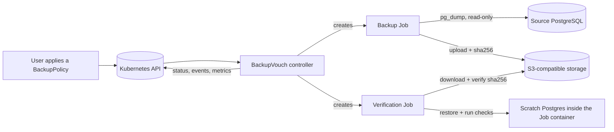
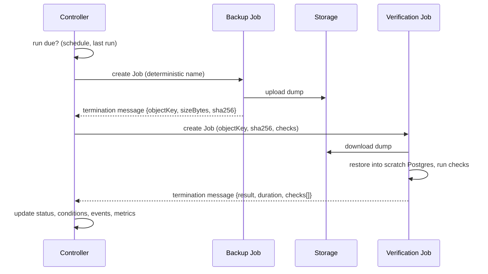
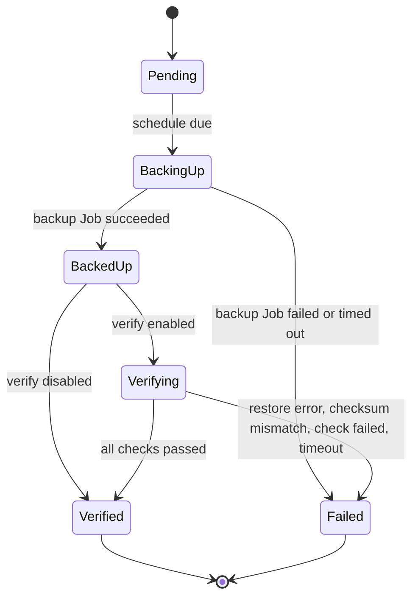

# ARCHITECTURE

## Components

- **Controller**: reconciles `BackupPolicy`. It decides when a run is due, creates Jobs, reads results, updates status, emits events and metrics. It never connects to the database or the storage itself.
- **Runner image**: one image with two subcommands. `runner backup` dumps and uploads. `runner verify` downloads, restores, and checks. It contains the Postgres client and server tools.
- **Jobs**: each run is two Kubernetes Jobs, owned by the BackupPolicy through owner references.
- **Scratch Postgres**: started with `initdb` and `pg_ctl` inside the verification Job's own container (non-root, data on an `emptyDir`). No sidecar, no Service, nothing listening outside the container.

## One run

## State of a run

`status.phase` shows the current stage: `Idle`, `BackingUp`, or `Verifying`. The result of the last run is in `status.lastBackup` and `status.lastVerification`.

## Reconcile rules

1. Compute whether a run is due from `spec.schedule`, `spec.timeZone`, and the last run time. Suspended policies do nothing.
2. Job names are deterministic: `<policy>-backup-<runID>` and `<policy>-verify-<runID>`, where `runID` is the scheduled time as a Unix timestamp. Creating a Job that already exists is a no-op, so a repeated reconcile or a crash never creates a duplicate.
3. Job outcome is read from the Job status and from the terminated container's message (JSON) on the Job's Pod.
4. Everything the controller needs to resume is in the resource status and the Jobs themselves. The controller keeps no in-memory state across reconciles.
5. Retention runs only after a successful verification and never deletes the newest verified backup.
6. On deletion a finalizer removes owned Jobs. Stored backups are kept unless the user opts in to deleting them (post-v1).

## Termination message formats

Backup: `{"objectKey":"app/2026-10-24T02-00-00Z.dump","sizeBytes":1234,"sha256":"..."}`

Verify: `{"result":"Passed","restoreDurationSeconds":12.3,"checks":[{"name":"users-not-empty","passed":true,"message":""}]}`

## Failure modes

| Failure | Detection | Result |
|---|---|---|
| Source unreachable | backup Job fails | `BackupReady=False`, reason `SourceUnreachable` or `BackupJobFailed`, event |
| Storage unreachable | backup or verify Job fails | reason `StorageUnreachable` |
| Backup runs too long | Job `activeDeadlineSeconds` | reason `BackupTimeout` |
| Dump downloaded is different | checksum mismatch in verify | `RestoreVerified=False`, reason `ChecksumMismatch` |
| Restore fails | `pg_restore` exits non-zero | reason `RestoreFailed` |
| A check returns the wrong answer | check result | reason `CheckFailed`, failing check named |
| Verification runs too long | Job deadline | reason `VerificationTimeout` |
| Termination message missing or invalid | parse error | the run is Failed, reason `InvalidRunnerResult` |
| Controller restarts mid-run | state is in status and Jobs | resumes at the correct stage, no duplicates |
| Policy deleted mid-run | finalizer | Jobs are removed |

## Metrics

| Metric | Type | Labels |
|---|---|---|
| `backupvouch_last_backup_timestamp_seconds` | gauge | namespace, policy |
| `backupvouch_last_verified_timestamp_seconds` | gauge | namespace, policy |
| `backupvouch_verification_success` | gauge (1 or 0) | namespace, policy |
| `backupvouch_restore_duration_seconds` | gauge | namespace, policy |

## Events

`BackupStarted`, `BackupSucceeded`, `BackupFailed`, `VerificationStarted`, `VerificationPassed`, `VerificationFailed`.

## Recommended NetworkPolicy for Jobs

Allow egress only to DNS and to the storage endpoint, plus egress to the source database for backup Jobs. Verification Jobs need no database access.
